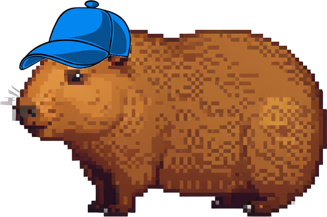
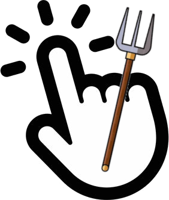
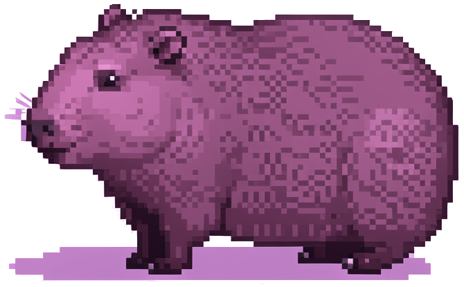

# capybara-clicker
A clicker game where you click the capybara and upgrade

## Demo URL
https://222erik.github.io/capybara-clicker/

## How to play 🎮
It's straightforward. Click the capybara either by clicking on it or by clicking space. Buy shop items when you can.
### Little cheat buttons
Those red buttons are there for a reason.

## What is AI generated 🤖
The capybara is AI generated. Very little of the code is AI generated. If you want to know exactly what, it's this:
- Lines 22-45 in **app.js**
- Lines 193-221 in **styles.css**
- Lines 93 and 96-99 in **styles.css**
- Line 52 in **styles.css**
- Total 59 lines

## Tech stack 👨‍💻
Built with vanilla **HTML**, **CSS** and **JS**. No frameworks. Developed in **LazyVim**.

## Features 🌟
- Skins
- Animations/effects
- A spinning sun
- CPS counter (clicks per second)
- Cheat buttons
- A shop

## Shop
The shop is the place for buying things.
### Mr Clicker 
He makes your clicks more powerful by +50/click.
### CapyCap 
The friendly skin that wears a cap.
### Clicker Farm 
Farming 50'000 clicks/second
### President Clicker 
The president of clickers that increases your click power by 1 million.
### The Purple Skin 
The most expensive skin.
